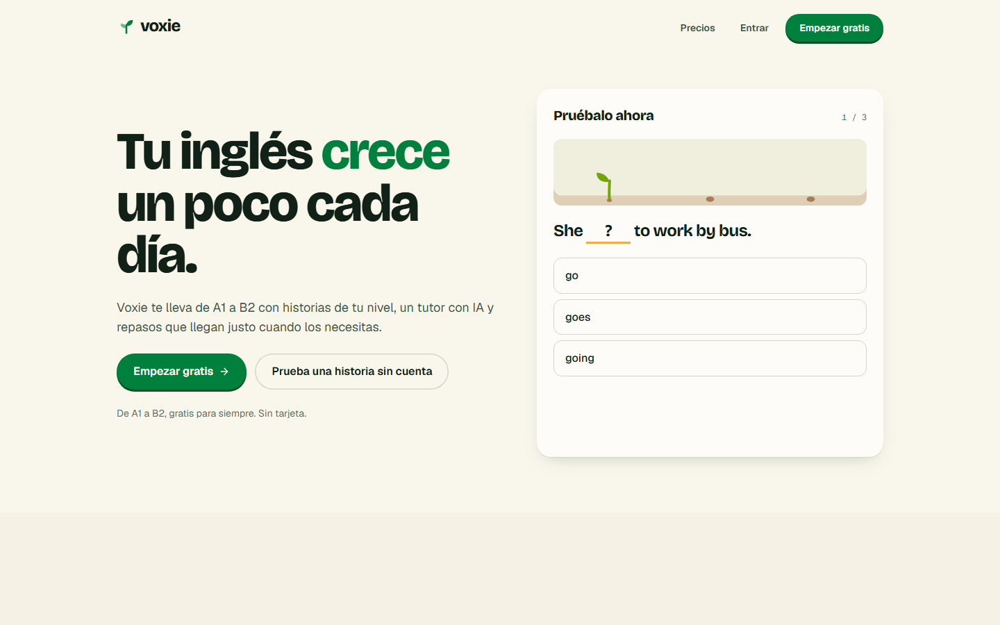
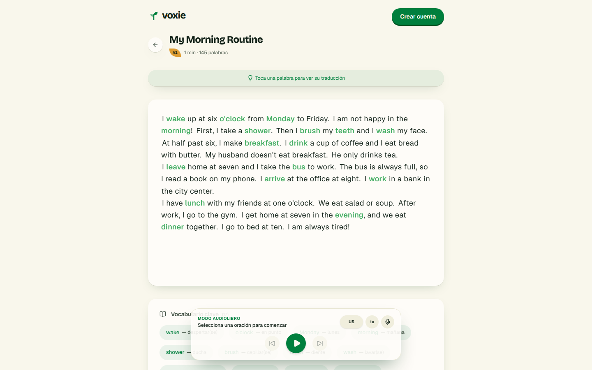
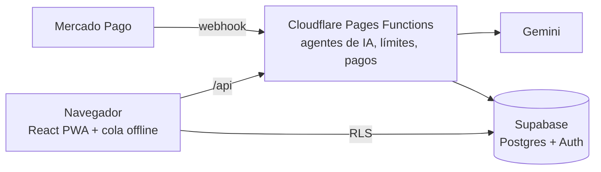

# Voxie

App web para aprender inglés de A1 a B2 con historias, repaso espaciado y un tutor con IA.

- **Demo:** [voxie.pages.dev](https://voxie.pages.dev)
- **Sin cuenta:** [voxie.pages.dev/probar](https://voxie.pages.dev/probar) abre una historia, y desde ahí la prueba de nivel.
- **Autor:** Luis ([@Keabop](https://github.com/Keabop)). Diseño, frontend, backend, contenido y datos.



## Qué hace

- Unidades de A1 a B2 con vocabulario, gramática, escucha, escritura y habla. El habla se puede dejar para después: la unidad queda hecha y el examen del nivel espera a que se complete.
- Ruta de aprendizaje como un jardín: cada unidad es una planta que crece, en 3D o en una lista de parcelas.
- 80 historias graduadas con audio y traducción palabra por palabra.
- Mazos de repaso con repetición espaciada (FSRS).
- Tutor de conversación, y evaluación de escritura y habla con la escala del MCER.
- Prueba de nivel y examen de fin de nivel.
- Racha en la hora local del alumno, meta diaria y congelador de racha.
- Instalable (PWA) y usable sin conexión, en español e inglés, con modo claro y oscuro.
- Se actualiza sola entre tareas: una versión nueva nunca interrumpe una lección; si la detecta a media tarea, avisa con un botón.



## Cómo está hecha



- **La IA solo corre en el backend.** Un orquestador valida la petición, aplica los límites del plan y elige el agente: tutor, generador de historias o evaluadores. Si un modelo de Gemini falla o se queda sin cuota, pasa al siguiente de una cadena de modelos gratuitos.
- **Evaluadores con la escala del MCER.** Califican según los descriptores del nivel. El texto del alumno va delimitado para que no pueda pedirle al modelo su propia calificación. El puntaje sale de los subpuntajes que ve el alumno (en escritura, mayúsculas y puntuación no cuentan como error), y si la respuesta coincide con la modelo no se llama a la IA.
- **Datos protegidos en la base.** Cada tabla tiene RLS. La racha y la meta diaria solo cambian a través de una función de Postgres, y un trigger rechaza los cambios directos desde el navegador.
- **Sin conexión.** TanStack Query persiste las consultas, y las escrituras se encolan en IndexedDB hasta que vuelve la red.
- **Actualizaciones.** El service worker (`vite-plugin-pwa` en modo `prompt`) deja la versión nueva esperando; `UpdatePrompt` la busca cada 15 minutos y al volver a la pestaña, y la aplica al abrir la app o al pasar a una pantalla sin tareas a medias (`src/lib/updatePolicy.ts`).
- **Diseño.** Sistema «Jardín»: la app es una libreta de campo (hojas rayadas, fichas, especímenes) y el progreso, un jardín. El jardín 3D (three.js) sólo vive en la Ruta y se carga aparte.
- **Contenido propio.** Las historias, los ejercicios y los exámenes están en `src/data/`. El audio se genera fuera de línea con Kokoro (Ogg Opus) y la app lo sirve como archivos estáticos.
- **Pruebas.** Casi 500 tests con Vitest: FSRS, orquestador, evaluadores, pagos, webhook y pantallas de lección.

## Stack

React 19, Vite 8, TypeScript 7, Tailwind 4, PWA, TanStack Query, i18next, Framer Motion, three.js, Supabase, Gemini y Mercado Pago. Se publica en Cloudflare Pages: `functions/api/` son las rutas del backend y `server/` el código que comparten (agentes de IA, límites de uso, CORS).

## Desarrollo

```bash
npm install
npm run dev
```

Variables del cliente en `.env.local`:

```
VITE_SUPABASE_URL=
VITE_SUPABASE_ANON_KEY=
```

Variables del backend en `.dev.vars` (las lee `wrangler pages dev`; en producción van en Cloudflare Pages → Settings → Variables and Secrets):

```
SUPABASE_URL=
SUPABASE_SERVICE_ROLE_KEY=
GEMINI_API_KEY=
MERCADOPAGO_ACCESS_TOKEN=
MERCADOPAGO_WEBHOOK_SECRET=
MERCADOPAGO_TEST_PAYER_EMAIL=
APP_URL=
```

Ninguno de los dos archivos se sube a git.

## Scripts

| Comando | Qué hace |
|---|---|
| `npm run dev` | Servidor de desarrollo en el puerto 5173 |
| `npm run build` | Revisión de tipos (cliente y funciones) y build de producción |
| `npm run pages` | Build y servidor local de Cloudflare con el backend en el puerto 8788 |
| `npm run test:run` | Pruebas con Vitest |
| `npm run content:audit` | Estado del contenido de enseñanza frente a sus metas (historias, vocabulario, exámenes) |

## Base de datos

Las migraciones viven en `supabase/migrations/` en orden cronológico.

## Versiones

Cada versión está en [CHANGELOG.md](CHANGELOG.md) y en las releases de GitHub. Se generan con release-please a partir de los commits (Conventional Commits).

## Licencia

El código es público para que se pueda leer y evaluar, pero **no es de código abierto**: todos los derechos son reservados. No se permite copiarlo, modificarlo, distribuirlo ni usarlo sin permiso del autor. Ver [LICENSE](LICENSE).

## Datos de terceros

- **CEFR-J Wordlist 1.5**, compilada por Yukio Tono, Tokyo University of Foreign Studies:
  niveles de referencia del vocabulario (`content/reference/`).
- **CMU Pronouncing Dictionary**, © Carnegie Mellon University (licencia BSD en
  `content/reference/CMUDICT-LICENSE`): pronunciaciones.
